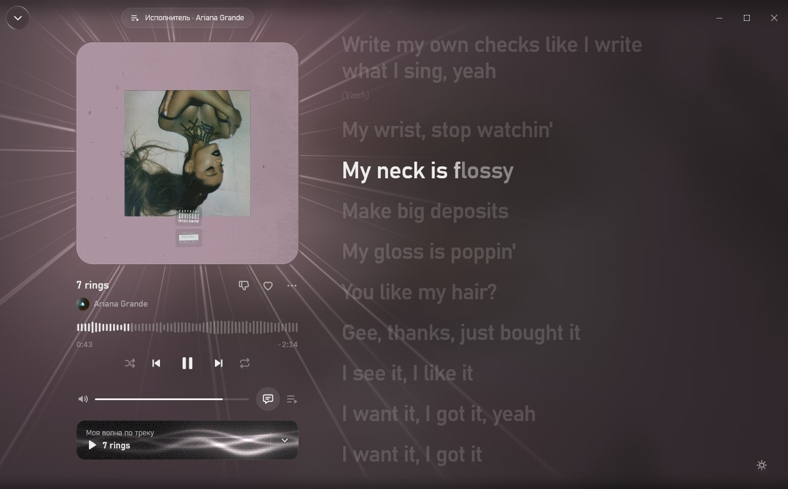
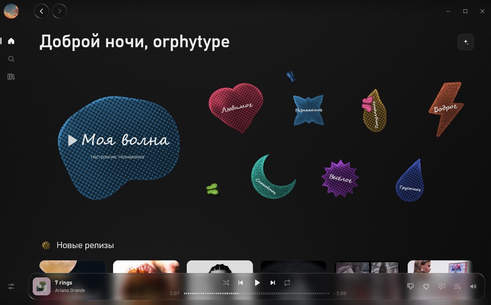
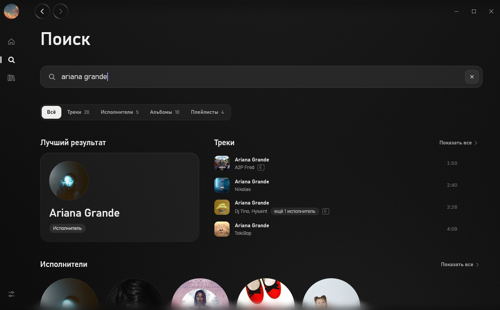
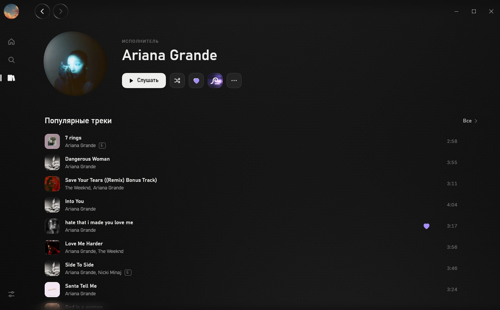
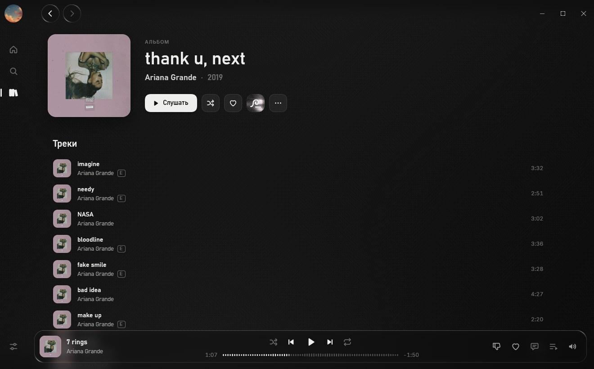
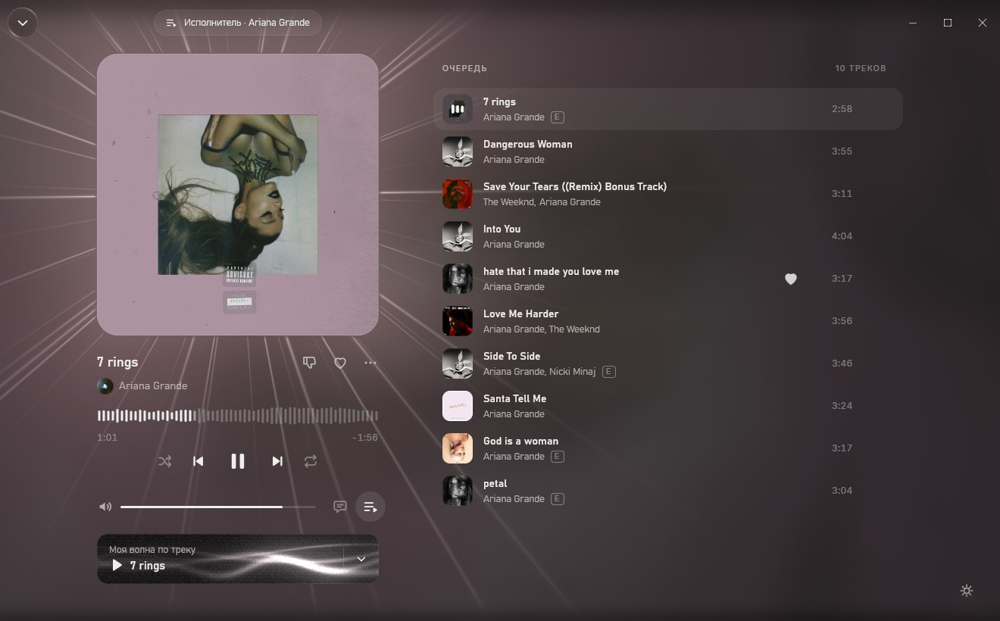
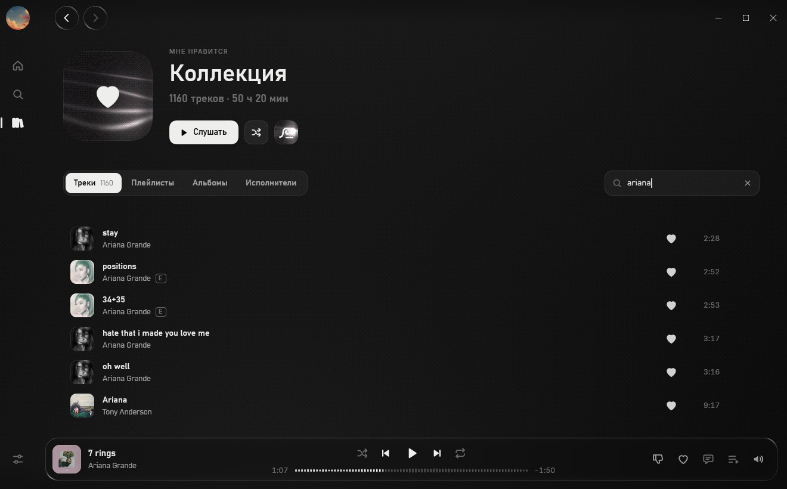

<div align="center">


# Glint

Неофициальный клиент Яндекс Музыки для Windows и Linux на Rust.

[](LICENSE)
[](#установка)
[](#установка)
[](rust-toolchain.toml)
[](https://github.com/anomalyco/rune)



</div>

## О приложении

Клиент Яндекс Музыки для Windows и Linux. Поиск, библиотека, страницы альбомов и исполнителей,
«Моя волна» и синхронизированные тексты.

Демо-режим работает без аккаунта и сети.

## Возможности

- «Моя волна» запускается по треку, исполнителю, альбому или всей коллекции.
- Поиск находит треки, исполнителей, альбомы и плейлисты, а историю запросов можно очистить.
- В коллекции есть любимые треки, плейлисты, альбомы и исполнители.
- Страницы релизов и исполнителей показывают жанры, год, треки, дискографию и похожих исполнителей.
- Очередь поддерживает перемешивание, повтор и переход к следующему треку без паузы.
- Текст песни синхронизируется по строкам, а lrc.red добавляет отметки по словам.
- FckCensor подменяет доступные зацензуренные версии треков чистыми версиями из внешней базы FkCensorData; функцию можно выключить в настройках.
- Эквалайзер имеет десять полос и пресеты. Скачанные треки сохраняются вместе с обложками,
  метаданными, списками и текстами для работы без сети. Настройки показывают, сколько занимают
  обложки, аудио и метаданные, и позволяют очистить их по отдельности или всё сразу.

### Windows и Linux

- Медиаклавиши и карточка «Сейчас играет»: SMTC в Windows и MPRIS в Linux.
- Значок в трее с управлением воспроизведением.
- Запоминание размера и положения окна.

## Скриншоты

<table>
  <tr>
    <td></td>
    <td></td>
  </tr>
  <tr>
    <td align="center">Главная</td>
    <td align="center">Поиск</td>
  </tr>
  <tr>
    <td></td>
    <td></td>
  </tr>
  <tr>
    <td align="center">Страница исполнителя</td>
    <td align="center">Страница альбома</td>
  </tr>
  <tr>
    <td></td>
    <td></td>
  </tr>
  <tr>
    <td align="center">Очередь</td>
    <td align="center">Коллекция</td>
  </tr>
</table>

## Установка

Скачайте файлы на [странице релизов](https://github.com/orphytype/glint/releases).

### Windows

- `Glint-0.1.0-alpha-windows-x64-setup.exe`. Установщик Windows для текущего пользователя.
- `Glint-0.1.0-alpha-windows-x64-portable.zip`. Portable-версия. Пока рядом с `glint.exe` лежит файл `glint.portable` (он уже в архиве), данные хранятся в папке `data`.

### Linux

Нужен драйвер Vulkan, например Mesa. Сборка сделана на Debian 11, поэтому требуется glibc 2.31 или новее.

- AppImage. Сделайте файл исполняемым (`chmod +x`) и запустите.
- `.deb`. Установите пакет командой `sudo apt install ./glint_*.deb`.
- `.rpm`. Установите пакет командой `sudo dnf install ./glint-*.rpm`.
- `tar.gz`. Распакуйте архив и запустите `./install.sh`. Установка идёт в `~/.local`, удаление выполняется командой `./install.sh --remove`.

## Сборка

Нужны [rustup](https://rustup.rs) и Rust 1.100.0. Версию из `rust-toolchain.toml` rustup установит сам.

На Debian или Ubuntu поставьте системные зависимости:

```bash
sudo apt install build-essential pkg-config libasound2-dev libfontconfig1-dev libwayland-dev
```

Соберите приложение:

```bash
git clone https://github.com/orphytype/glint.git
cd glint
cargo build --release
```

Бинарники: `target/release/glint.exe` на Windows и `target/release/glint` на Linux.

Для пакетов используются `scripts/dist-windows.ps1` и `scripts/dist-linux.sh`. Windows-скрипту нужен
[Inno Setup 6](https://jrsoftware.org/isinfo.php), параметр `-Only portable` оставляет только portable zip.
Linux-скрипту нужны `cargo-deb` и `cargo-generate-rpm`.

Релизные сборки запускаются с `--no-default-features`, поэтому в них нет инструментов разработки из
фичи `tooling`.

## Вход

1. Нажмите «Открыть вход Яндекса».
2. Войдите в браузере и разрешите доступ.
3. Скопируйте адрес после перенаправления или только значение `access_token`, вставьте его в Glint и нажмите «Войти».

Glint не получает пароль. На Windows токен шифруется DPAPI для текущего пользователя. На Linux это
файл с правами `0600`. Кнопка «Выйти» удаляет токен.

## Обновления

При запуске Glint смотрит релизы на GitHub. Если вышла новая версия, в «Настройках → Обновления» появится кнопка «Обновить и перезапустить». Ничего не ставится без вашего нажатия, проверку можно отключить там же.

- Windows, установщик: скачивается новый `setup.exe` и тихо ставится поверх.
- Windows, portable: заменяется `glint.exe` рядом с `glint.portable`.
- Linux, AppImage: заменяется сам файл AppImage.
- `.deb`, `.rpm`, `tar.gz` и сборка из исходников: Glint только сообщает о новой версии и открывает страницу релиза.

Файл скачивается только из релизов этого репозитория и ставится, если его SHA-256 совпал с тем, что указал GitHub. Пре-релизы предлагаются только тем, кто сам на пре-релизе.

## Данные

| Что | Windows | Linux |
|---|---|---|
| Настройки | `%APPDATA%\Glint\settings.json` | `~/.config/glint/settings.json` |
| Токен | `%APPDATA%\Glint\token.bin` | `~/.config/glint/token.bin` |
| Положение окна | `%APPDATA%\Glint\window.json` | `~/.config/glint/window.json` |
| Кэш обложек и метаданных | `%LOCALAPPDATA%\Glint\Cache\metadata` | `~/.cache/glint/metadata` |
| Скачанные треки и их данные | `%LOCALAPPDATA%\Glint\Cache\downloads` | `~/.cache/glint/downloads` |

Переменная `GLINT_DATA_DIR=<папка>` задаёт другой корень для всех данных.

## Горячие клавиши

| Клавиша | Действие |
|---|---|
| `Пробел` | Пауза или воспроизведение |
| `←` `→` | Перемотка на 5 секунд |
| `Ctrl` + `←` `→` | Предыдущий или следующий трек |
| `Alt` + `←` `→` | Назад или вперёд по страницам |
| `↑` `↓` | Громкость |
| `L` | Лайк |
| `M` | Без звука |
| `F` | Открыть или закрыть плеер |
| `Ctrl` + `K` | Поиск |
| `Esc` | Назад |

Буквенные клавиши работают и в русской раскладке.

## Для разработчиков

Правила локальной разработки и pull request находятся в [`CONTRIBUTING.md`](CONTRIBUTING.md).

```bash
cargo test --workspace
cargo run --release -- --list-scenes
cargo run --release -- --snap out.png --scene nowplaying --size 1320x820
```

Сцены используют локальные демо-данные.

Основные части проекта находятся в `crates/ym-api`, `crates/ym-audio` и `crates/glint`.

## Важно

- У Яндекс Музыки нет открытого API для сторонних плееров. Glint обращается к тем же адресам, что и официальные приложения, и может перестать работать или нарушать условия сервиса. Используйте свой аккаунт на свой риск. Glint воспроизводит только то, что доступно в вашей подписке.
- Glint не связан с Яндексом и не одобрен им.
- Лицензии сторонних компонентов перечислены в [`NOTICE.md`](NOTICE.md).

## Лицензия

[GPL-3.0](LICENSE).

## Отказ от ответственности за FckCensor

FckCensor использует внешнюю общественную базу FkCensorData и ссылки на аудиофайлы, которыми Glint
не владеет и которые не распространяет в составе программы. Доступность, точность, законность и
права на эти материалы не гарантируются. Используйте функцию только если принимаете условия
внешних источников и ответственность за их использование.
