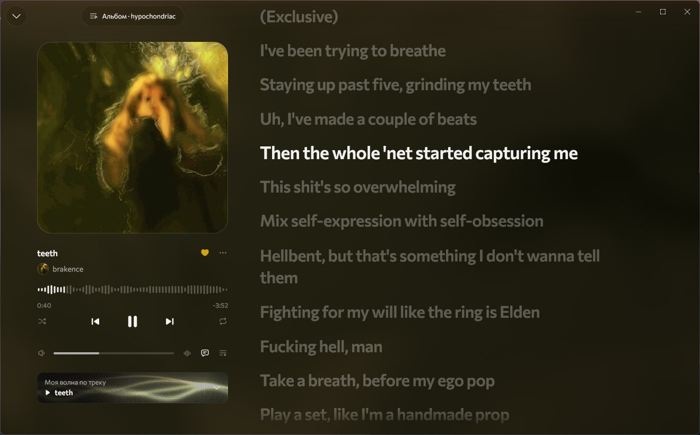

<div align="center">


# Glint

An unofficial Yandex Music client for Windows, macOS and Linux.



</div>

## Download

Get a build from the [releases page](https://github.com/orphytype/glint/releases).

- Windows 10 and 11: `setup.exe` or the portable `.zip`
- macOS 11 and newer: `.dmg`. The app is not signed, so on first launch right-click it and choose Open.
- Linux x86_64: AppImage, `.deb`, `.rpm` or `.tar.gz`. You need a Vulkan driver.

## Sign in

1. Press "Open Yandex sign-in" and sign in in your browser.
2. Copy the address of the page you land on, or just the `access_token` value.
3. Paste it into Glint and press "Sign in".

## Build

You need [rustup](https://rustup.rs). On Debian and Ubuntu, also install
`build-essential pkg-config libasound2-dev libfontconfig1-dev libwayland-dev`.

```bash
git clone https://github.com/orphytype/glint.git
cd glint
cargo build --release --no-default-features
```

The binary is `target/release/glint` (`glint.exe` on Windows). To work on the code, read
[CONTRIBUTING.md](CONTRIBUTING.md).

## License

[GPL-3.0](LICENSE). Third-party licences are in [NOTICE.md](NOTICE.md). Glint is not affiliated with Yandex.
